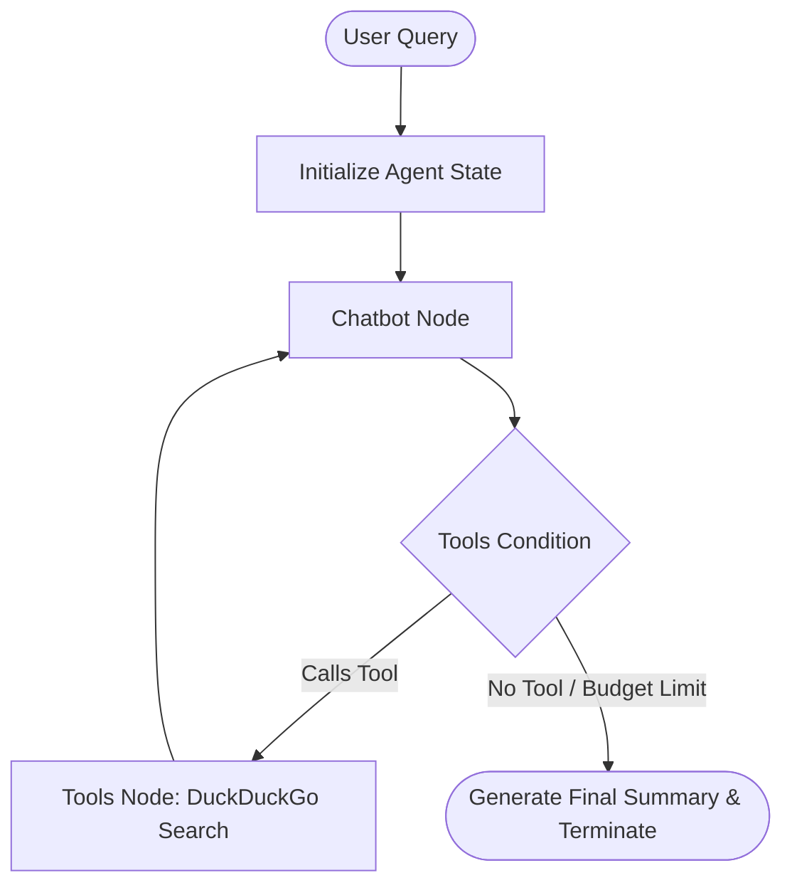

# Pathfinder: Autonomous Web Research Assistant & Agent

**Pathfinder** is a production-ready, task-oriented AI agent built using LangGraph, FastAPI, and React.js. It performs multi-step reasoning, self-reflection, and tool invocation to satisfy complex research objectives (e.g., *"Summarize the latest AI safety guidelines in the EU"*).

Rather than producing a single, immediate LLM response, Pathfinder functions as a cyclic agent: it dynamically plans queries, searches the web, digests snippets, decides if additional search is required, and summarizes findings with citations.

---

## Key Features

* **Adjustable Search Budget**: Control agent loops via a slider (1-8 steps) on the UI. The agent automatically halts tool-calling and switches to synthesis once the budget is exhausted.
* **One-Click Export & Copy**: Export the final report and chronological reasoning log directly into a clean `.md` Markdown file, or copy the summary with one click.
* **Rich Sources with Favicons**: View web search results inside structured cards complete with clickable hyperlinks and favicons dynamically resolved via Google Favicon API.
* **Search History Sidebar**: Persistent storage using browser `localStorage` allows you to cache up to 20 past runs and load them instantly without re-invoking the LLM.
* **Dual Theme Support**: Floating toggle button switches UI between Neon Glassmorphic Dark Mode and high-contrast Light Mode.

---

## Tech Stack

* **Backend Orchestration**: Python 3.10+, LangGraph, LangChain, Groq API (Llama 3.1)
* **Backend Framework**: FastAPI, SSE (Server-Sent Events) for real-time thought streaming
* **Frontend**: React.js, Lucide Icons, Custom CSS variables design system
* **Bundler & Tooling**: Vite, ESLint

---

## System Architecture & Graph Flow

Pathfinder is structured as a stateful, cyclic graph using **LangGraph**. The workflow comprises two primary nodes and conditional edges:



1. **State Definition**: Tracks conversation history `messages`, execution loop count `loop_count`, and the user's budget `max_searches`.
2. **Chatbot Node**: Inspects state and compiles the prompt. If `loop_count` is less than `max_searches`, it binds search tools. If the budget is exhausted, it overrides instructions to force a summary.
3. **Tools Node**: Executes the `web_search` tool using DuckDuckGo and appends output.
4. **Conditional Edge**: Routes back to the chatbot if the chatbot calls a tool and budget remains, otherwise terminates.

---

## Repository Structure

```
├── main.py                # FastAPI Application exposing SSE streaming endpoints
├── agent.py               # LangGraph Agent state definition and graph compilation
├── requirements.txt       # Python dependencies
├── .gitignore             # Standard git ignore definitions
└── frontend/              # React frontend
    ├── src/
    │   ├── App.jsx        # Main Dashboard, Sidebar, and Markdown parsing logic
    │   ├── index.css      # Custom Glassmorphic/Light Mode design system
    │   └── main.jsx       # React application root
    ├── package.json       # Frontend dependencies
    └── vite.config.js     # Vite configuration
```

---

## Getting Started

### 1. Backend Setup
Clone the repository and install requirements:
```bash
# Create and activate virtual environment
python -m venv venv
venv\Scripts\activate      # On Windows
source venv/bin/activate   # On macOS/Linux

# Install dependencies
pip install -r requirements.txt
```

Create a `.env` file in the root directory and add your Groq API Key:
```env
GROQ_API_KEY=your_groq_api_key_here
```

Start the backend server:
```bash
python main.py
```
*Backend runs on `http://127.0.0.1:8000`.*

### 2. Frontend Setup
Navigate to the `frontend` folder and run development build:
```bash
cd frontend
npm install
npm run dev
```
*Frontend runs on `http://localhost:5173`.*

---

## Interview Prep Guide (For Your Resume)

If you feature this project on your resume, prepare to talk about these architectural choices:

### 1. LangGraph vs. Standard LangChain Chains
Standard LangChain runs *linear* execution flows (DAGs). Autonomous agents require loops (e.g., retry search if a link fails). LangGraph models agents as stateful graphs with cyclical edges, enabling reasoning, tool calling, and self-correction cycles.

### 2. The ReAct (Reasoning and Acting) Paradigm
Pathfinder splits agent cycles into distinct phases:
* **Reasoning**: Decides *what* it needs to search.
* **Acting**: Executes the search tool.
* **Self-Reflection**: Analyzes if the retrieved search results are sufficient to answer the prompt.

### 3. Server-Sent Events (SSE) vs. WebSockets for Streaming
For unidirectional streaming of thought processes (Agent -> UI), **SSE** (Server-Sent Events) is lighter, simpler, and automatically handles reconnection, making it a better architectural choice than WebSockets for this usecase.

### 4. State Persistence and Token Economics
We control token consumption and prevent infinite loops by defining a strict `max_searches` budget in the agent's state, preventing the LLM from entering runaway search loops.
